

  

<h1 align="center">ABShare</h1>

<strong>Your audiobook library, shared with the people you choose, on every phone and computer they own.</strong>

  <a href="docs/DEPLOY.md">Installation</a> ·
  <a href="docs/FEATURES.md">All features</a> ·
  <a href="docs/ARCHITECTURE.md">How it works</a> ·
  <a href="SECURITY.md">Security</a> ·
  <a href="docs/README.md">Documentation</a>

ABShare is a small, self-hosted server for sharing an audiobook library with friends and family over the internet. Point it at a folder of audiobooks and invite the people you want. They listen in a web app that installs on a phone, tablet or computer: it keeps playing with the screen locked, remembers everyone's place in every book across all their devices, saves data on mobile networks and downloads books for listening offline. Your library is never written to, and nothing leaves your server.

It is built to face the internet. Security is the first requirement, and every design choice is weighed against attack surface before convenience.

  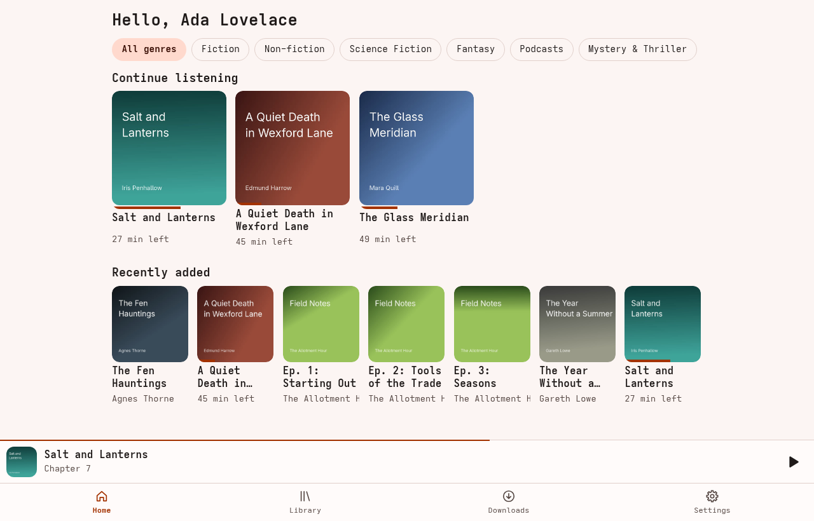

> The screenshots come from a synthetic demo library ([`tools/demo/make-showcase.sh`](tools/demo/make-showcase.sh)). Every book, author, narrator and cover in them is invented.

## What it does

- **Listen anywhere.** An installable web app (PWA) for iPhone, iPad, Android and desktop, with lock-screen and headset controls, chapters, a chapter-relative scrubber, skip back and forward, speed from 0.75× to 3× with pitch kept, a sleep timer (or end of chapter) that fades out, and bookmarks.
- **Pick up where you left off.** Your place in each book follows you between devices. Listening done offline is queued and merged when the device is back online, and the newest listening wins.
- **Data saver.** On mobile data, books stream as a small mono MP3 (48 kb/s by default, or 40 or 32) with exact seeking. Automatic mode picks it when the browser reports a cellular or data-saving connection.
- **Offline.** Download a book in original quality or data saver and listen with no connection at all. Downloads resume if interrupted, and each person's downloads are kept apart.
- **Browse the way people think.** Continue listening, the next book in your series, and recently added on Home. Search titles, authors and narrators. Series and podcast-style shows are grouped automatically, and messy store genre tags are sorted onto 17 familiar shelves, fiction and non-fiction.
- **Invite-only accounts.** Single-use invite links. Sign in with a passkey, or a password plus an authenticator app. Recovery codes, a list of your devices, and remote sign-out.
- **Admin in the app.** People, invites, library scans and problems, a tamper-evident audit log, security status, and corrections to any book's details.
- **Your library stays as it is.** ABShare reads your files in place and never writes, renames or deletes anything in them. Changes you make in the app live in its own database.

The full list is in [`docs/FEATURES.md`](docs/FEATURES.md).

  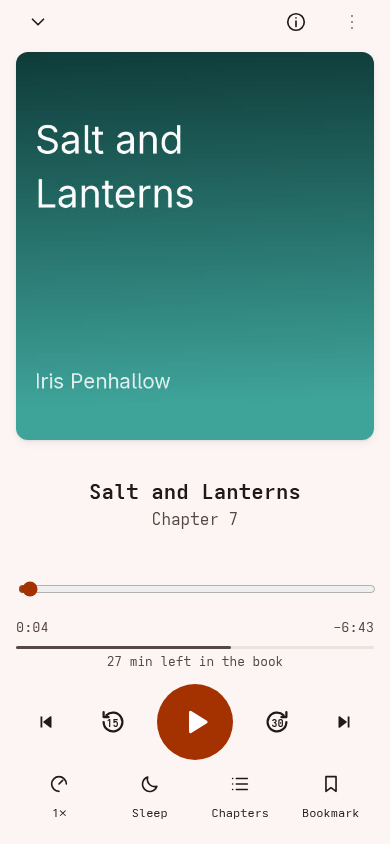
  &nbsp;
  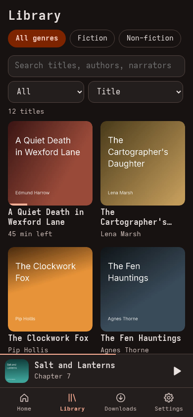
  &nbsp;
  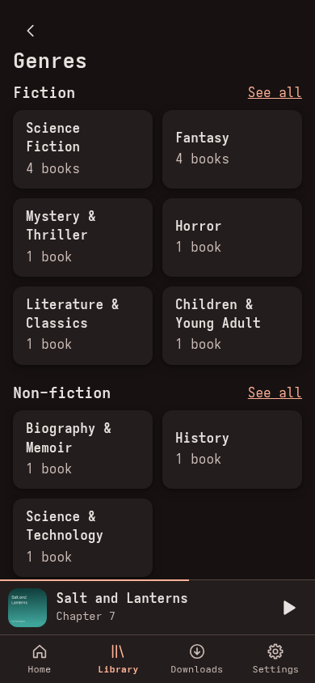

## Under the bonnet

- **One Rust binary and one SQLite database.** The `abshare` server (axum on tokio and hyper) scans the library, serves the API, the audio and the web app, and owns accounts. It makes no outbound network connections at all: no metadata services, no update checks, no telemetry.
- **ffmpeg runs only in a jail.** Every ffmpeg and ffprobe run goes through `abshare-jail`, a small helper of ours that applies Linux Landlock (read only the named inputs, write only the job directory, execute nothing else, no network), a seccomp filter (no sockets, no new processes, no foreign-architecture system calls) and resource limits before it becomes ffmpeg. A media file that exploits ffmpeg finds itself with nothing to reach.
- **Untrusted bytes go through a pure, fuzzed core.** Tags, ffprobe output, chapters, sidecar text, Range headers and genre tags are interpreted by the `core` crate, which does no I/O. It has 11 `cargo-fuzz` targets and must never panic. Covers are decoded and re-encoded in Rust, never served raw.
- **One timeline per book.** A single browser-friendly file plays as it is. Multi-part books and formats browsers can't play get one playable `.m4b` copy, built on demand in the jail. Data saver is a virtual constant-bitrate MP3 whose length is known exactly before any of it exists, so a Range request transcodes only the 60-second segments it touches.
- **A web app with no runtime dependencies.** SvelteKit 2 and Svelte 5, built to static files and served by the same process. A strict Content Security Policy with no inline scripts and Trusted Types, a build that fails on inline script, and a source scan that bans every HTML-injection API.
- **Sessions done carefully.** Opaque random tokens, never JWTs: a 15-minute access token held in memory, a refresh token rotated on every use with reuse detection, and a media cookie scoped to `/v1/media`, so no token ever appears in a URL. argon2id passwords, a breached-password check, lockouts that a stranger can't use to lock you out, and step-up for every sensitive change.

The detail, with request flows and diagrams, is in [`docs/ARCHITECTURE.md`](docs/ARCHITECTURE.md). Every design decision and its reason is recorded in [`SPEC.md`](SPEC.md).

<strong>More screenshots</strong>

  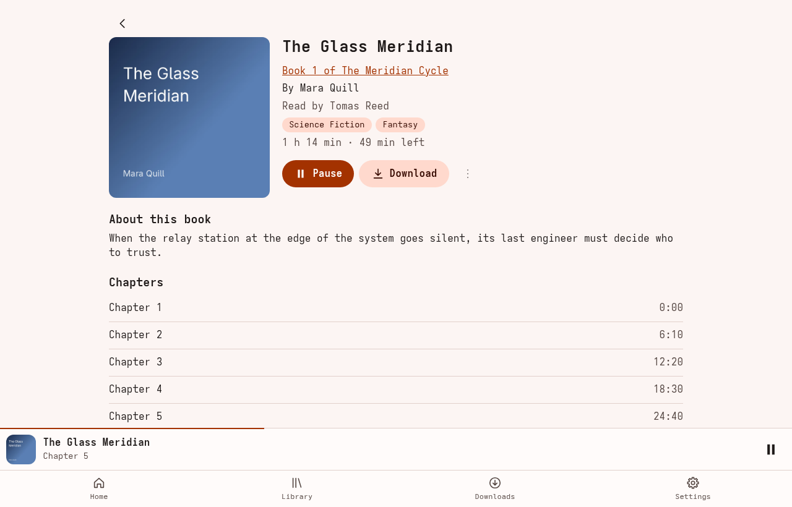

  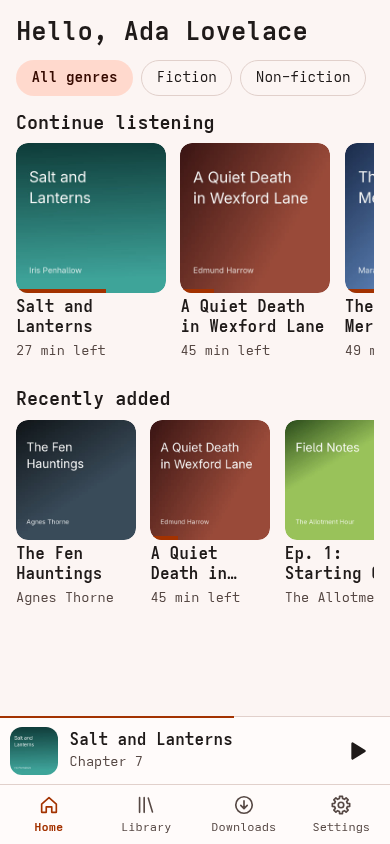
  &nbsp;
  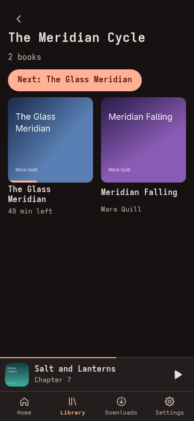
  &nbsp;
  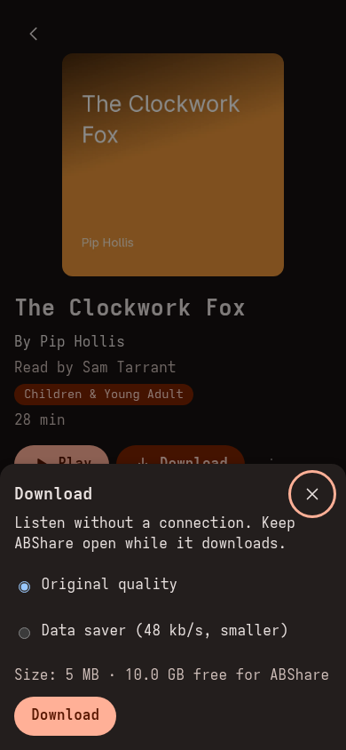

  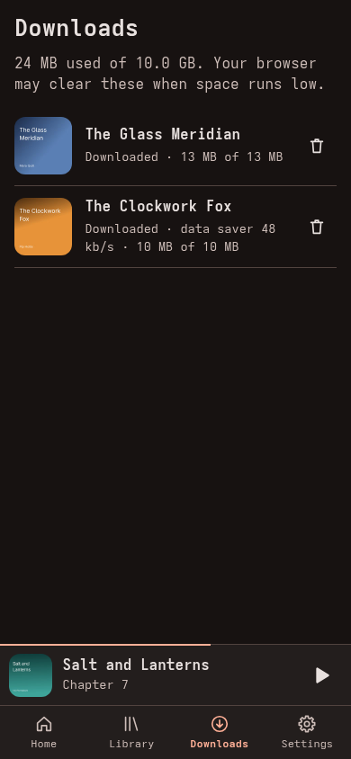
  &nbsp;
  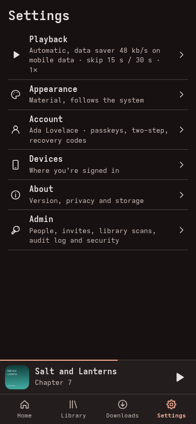
  &nbsp;
  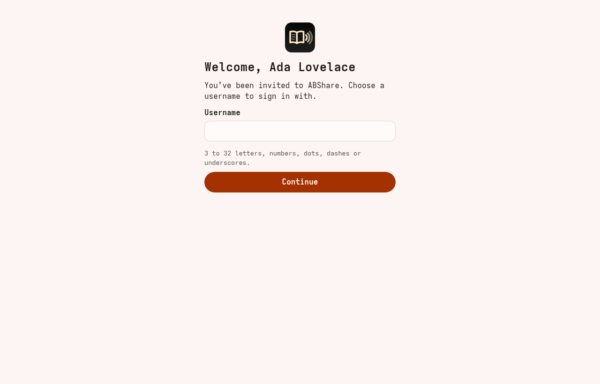

  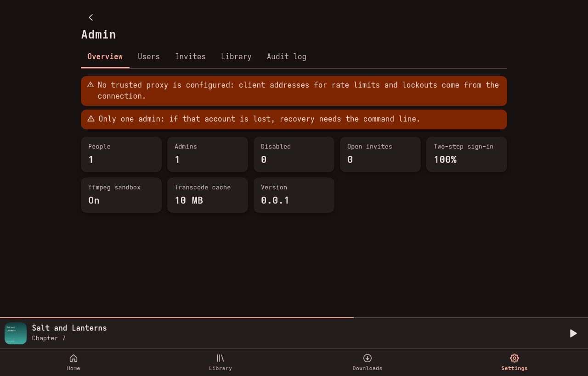

  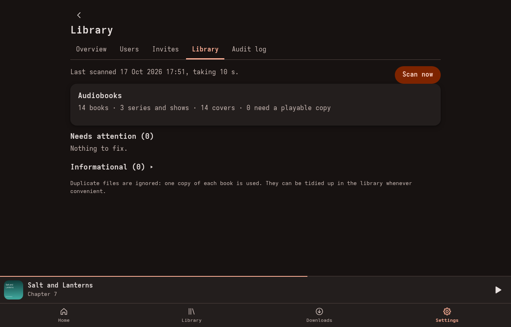

  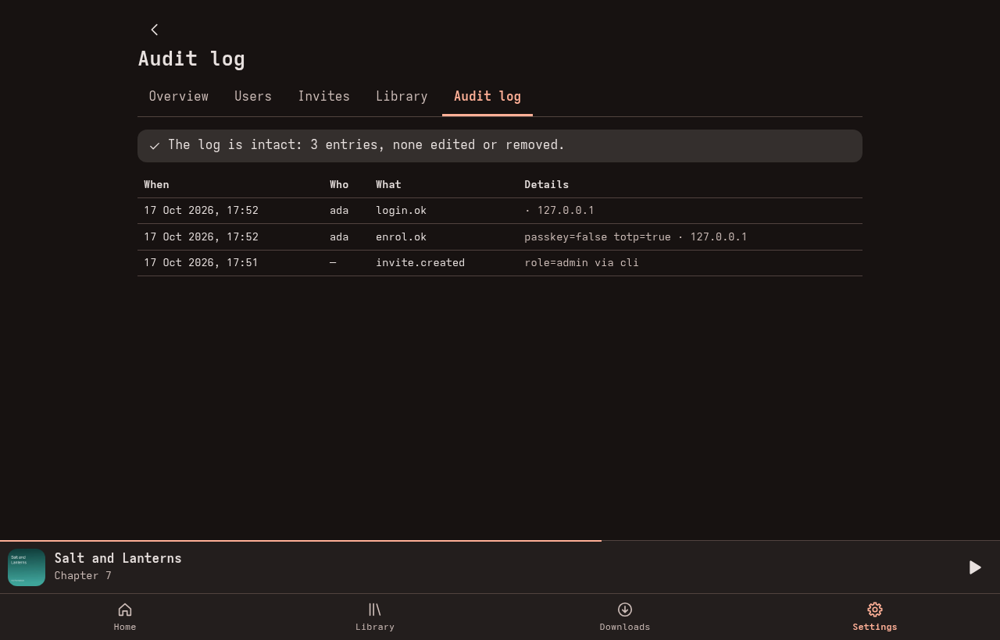

## Running it

ABShare runs as a Docker container (recommended) or a systemd service, behind your own HTTPS reverse proxy (nginx and Caddy examples are included). It needs Linux with Landlock enabled (kernel 6.12 or later), and about 2 GB of memory for transcoding. [`docs/DEPLOY.md`](docs/DEPLOY.md) walks through the whole set-up, from the read-only library mount to the first admin invite.

To try it locally with invented books, see [`docs/BUILDING.md`](docs/BUILDING.md#a-local-demo).

## Status

ABShare v1 is built and in use. An AI-assisted security review and black-box penetration test (Phase 6) found and fixed 4 high, 11 medium and about 25 low findings, each with a regression test; none of critical, high or medium severity remain open ([`docs/security/review-phase6.md`](docs/security/review-phase6.md)). An independent human review is still recommended. Native apps are not planned until the web app has proved itself; the API is ready for them ([`docs/API.md`](docs/API.md)).

## Documentation

Every document, with what it covers, is listed in [`docs/README.md`](docs/README.md).

## Licence

GPL-2.0-or-later. See [LICENSE](LICENSE).
