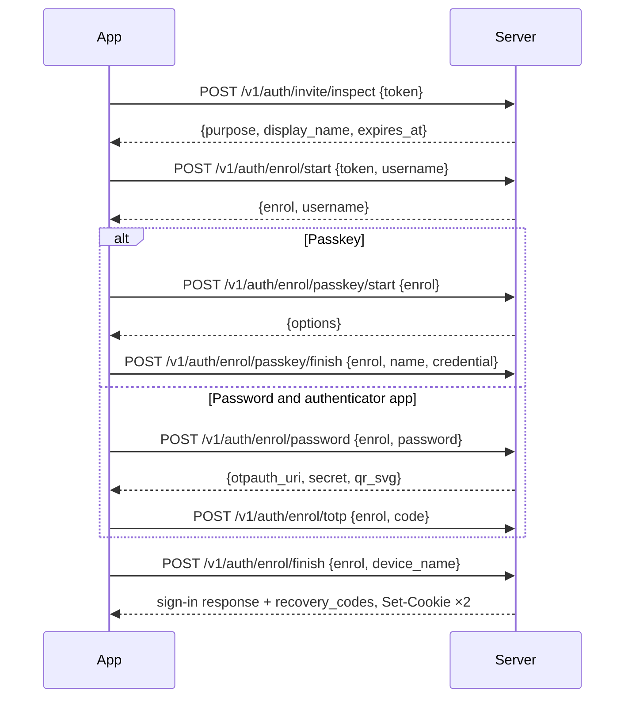
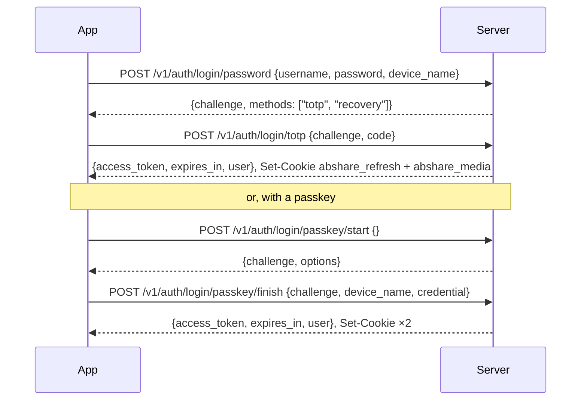

# ABShare HTTP API (v1)

This is the API as it is built. The server side is `server/src/http/` (`mod.rs` for the router, `guard.rs` for the request guard, and one `*_routes.rs` file per area); the web app's side is `web/app/src/lib/api/`. When this document and the code disagree, the code is right and this document has a bug.

Examples use `https://books.example.com` as the public origin, `10.0.0.10` as the reverse proxy, and invented users (`ada`, `joe`) and books.

## Contents

1. [Conventions](#1-conventions)
2. [Authentication](#2-authentication)
3. [Your account (`/v1/me`)](#3-your-account-v1me)
4. [Library](#4-library)
5. [Media](#5-media)
6. [Admin (`/v1/admin`)](#6-admin-v1admin)
7. [Health and the web app](#7-health-and-the-web-app)

## Endpoints at a glance

| Prefix | Purpose | Auth |
|---|---|---|
| `POST /v1/auth/…` | Invites, enrolment, sign-in, refresh, sign-out, step-up | none, a ceremony token, the refresh cookie, or bearer; always the CSRF check |
| `/v1/me/…` | Your profile, devices and sign-in methods | bearer (step-up for changes to sign-in methods) |
| `/v1/libraries`, `/v1/books…`, `/v1/genres`, `/v1/groups…`, `/v1/home`, `/v1/progress…`, `/v1/bookmarks/…` | Browsing, progress and bookmarks | bearer |
| `GET /v1/media/…` | Audio, the preparation state, saved files and covers | media cookie or bearer |
| `/v1/admin/…` | Users, invites, audit log, library, status, book corrections, start-up reports | bearer, admin role, step-up for changes |
| `POST /v1/diag` | A start-up report from a blank page | none; CSRF check; rate-limited |
| `GET /healthz` | Liveness | none |
| anything else | The built web app (static files) | none |

---

## 1. Conventions

### Transport and the request guard

Every request, including `/healthz` and static files, passes the front guard first (`guard::front`):

1. **TLS.** A request counts as TLS only if:
   - the TCP peer is a trusted proxy (`trusted_proxies` in the config) and it sent `X-Forwarded-Proto: https`; or
   - the peer is loopback and isn't listed as a trusted proxy (local tools and tests).

   Anything else gets `403 tls_required`. ABShare speaks plain HTTP itself; the proxy terminates TLS.
2. **Host.** `Host` must equal the host (and port, if any) of `public_origin`, ignoring case. Anything else gets `421 wrong_host`. This defeats DNS rebinding and host-header tricks.
3. **Client address.** For rate limits, lockouts and the audit log, the client address is:
   - the TCP peer, unless the peer is a trusted proxy;
   - otherwise the right-most `X-Forwarded-For` entry that isn't itself a trusted proxy. If any entry fails to parse, the proxy's own address is used.

   IPv4 addresses seen through an IPv6 socket (`::ffff:a.b.c.d`) are treated as plain IPv4.

There is no CORS. No route answers a preflight, so a cross-site page can't send custom headers or JSON to the API.

### Connection limits

- At most 1024 connections at once. A peer that isn't a trusted proxy may hold at most 64. Connections beyond either cap are closed as soon as they are accepted.
- A new connection must send its first byte within 15 s, and a request head must arrive within 15 s. Otherwise the connection is closed with no response.
- A request body (any method but `GET`, `HEAD` and `OPTIONS`) is read in full before the handler runs. It must arrive within 15 s (otherwise `408 timeout`) and be at most 64 KiB (otherwise `413 too_large`).
- Routes under `/v1/auth`, `/v1/me` and the library routes also refuse JSON bodies over 16 KiB, with a 413 from the framework (plain text, not the JSON error shape).
- Streamed responses (audio, covers) aren't subject to these time limits.

### Requests and responses

- Request bodies are JSON (`Content-Type: application/json`). Every body struct uses `deny_unknown_fields`, so unknown fields, missing required fields and wrong types are refused. Query strings are just as strict: an unknown query parameter is refused.
- Those refusals come from the framework, not from ABShare's handlers, and are plain text, not the JSON error shape:
  - a malformed or schema-violating JSON body: `422`;
  - a missing or wrong `Content-Type`: `415`;
  - a bad query string, or a path segment that should be a number but isn't: `400`;
  - a method the route doesn't declare: `405` (empty body).

  The web app reports these as `http_<status>`.
- Responses are JSON unless stated otherwise (audio, covers, static files, `/healthz`). A `204` has no body.
- **Times.** Unless stated otherwise, times are Unix seconds. Progress times (`updated_at`, `event_time_ms`) are Unix milliseconds by the client's clock. Durations and positions are milliseconds (`*_ms`).
- **Path IDs.**
  - Books and groups (series and shows) have opaque IDs: 26 characters of lower-case base32 (`a–z`, `2–7`). The shape is checked before any lookup, so a malformed ID is just `404`.
  - Users, devices, passkeys, bookmarks and invites have integer IDs.
  - Libraries have integer IDs.
- **Tokens.** Access tokens, media tokens, refresh tokens, invite tokens and ceremony tokens (`enrol`, `challenge`) are all 64 lower-case hex characters (256 bits). Anything else is refused without a lookup. Only hashes are stored.

### Errors

Errors from ABShare itself look like this:

```json
{ "error": "step_up_required", "message": "Confirm it's you first." }
```

`error` is a stable, machine-readable code; `message` is British English, safe to show. Internal errors carry a reference that is also written to the server log (`"Something went wrong (reference 1a2b3c4d5e6f)."`). Stack traces, paths and SQL never reach a client.

| Status | `error` | Meaning |
|---|---|---|
| 400 | `invalid` | A value failed validation; `message` says which (a weak password, an unknown sort, a bad idempotency key…) |
| 401 | `unauthenticated` | No usable access token, or the refresh cookie is missing, unknown or past its lifetime. Sign in again; downloads stay |
| 401 | `invalid_credentials` | Wrong username, password, code, passkey or ceremony token. Always the same answer, whichever part was wrong |
| 401 | `session_reused` | A refresh token was used twice outside the grace rules. The device is signed out for safety; the app keeps its downloads |
| 401 | `device_revoked` | The device was signed out elsewhere, or the user disabled. The app removes this device's downloads |
| 403 | `tls_required` | The front guard's TLS check failed |
| 403 | `csrf` | A `/v1/auth/*` request without `X-ABShare-Client: 1` or with the wrong `Origin` |
| 403 | `step_up_required` | The action needs a step-up within the last 10 minutes |
| 403 | `factor_required` | Signed in with a recovery code: only `/v1/me` and `/v1/auth` work until a new passkey or authenticator app is set up |
| 403 | `not_permitted` | Not an admin, or the account lacks the `offline` or `save_files` permission |
| 404 | `not_found` | No such thing, or not one the caller may see. A book outside the caller's libraries is always 404, never 403 |
| 408 | `timeout` | The request body took more than 15 s to arrive |
| 409 | `username_taken` | Enrolment: that username exists |
| 409 | `last_method` | Removing this would leave the account with no complete way to sign in |
| 409 | `confirm_admin` | Making someone an admin needs `"confirm_admin": true` |
| 409 | `last_admin` | The change would leave no enabled admin |
| 409 | `self` | An admin tried to disable or demote themselves |
| 409 | `too_many_bookmarks` | The bookmark limit is reached |
| 409 | `preparing` | The book's playable copy is being built: try again shortly |
| 410 | `enrolment_expired` | The enrolment token is unknown or expired: open the invite link again |
| 410 | `invite_used` | The invite was used or expired before enrolment finished |
| 413 | `too_large` | The body is over 64 KiB |
| 421 | `wrong_host` | The `Host` header doesn't match `public_origin` |
| 422 | `clock` | A progress event is stamped more than 5 minutes in the future |
| 422 | `too_old` | A progress event is more than 90 days old |
| 422 | `unplayable` | The book's playable copy couldn't be built (a damaged file, perhaps) |
| 429 | `too_many_requests` | A rate limit or lockout. No `Retry-After` is sent |
| 500 | `internal` | Something failed on the server; see the reference in the log |
| 503 | `busy` | Every password-hashing slot was busy for 2 s. Try again in a moment |

Clients should treat only ABShare's own JSON `401` as "signed out". A proxy's error page, of any status, isn't ABShare's answer.

### Authentication kinds

Each endpoint below names one of these.

| Kind | What the request carries |
|---|---|
| **none** | Nothing. Some of these routes are rate-limited per address |
| **invite** | An invite token in the body, then the `enrol` ceremony token it returns |
| **challenge** | A `challenge` ceremony token from the previous step of a sign-in, step-up or factor change |
| **refresh cookie** | The `abshare_refresh` cookie. It is only ever sent to `/v1/auth` |
| **bearer** | `Authorization: Bearer <access token>`. The prefix is case-sensitive |
| **media** | The `abshare_media` cookie (what `<audio src>` sends), or a bearer token |
| **admin** | Bearer, and the account is an enabled admin when the request is made (checked in the database, not just from the token) |
| **step-up** | Bearer, and this device completed a step-up within the last 10 minutes |

Everything under `/v1/auth` also passes the **CSRF check**, whatever its kind: the request must carry `X-ABShare-Client: 1` and an `Origin` exactly equal to `public_origin` (for example `https://books.example.com`). A missing `Origin` is refused. Other routes don't read cookies (apart from media `GET`s, which change nothing), so they don't need the check. The web app sends `X-ABShare-Client: 1` on every request anyway.

### Tokens and cookies

| Token | Lifetime | Where it lives |
|---|---|---|
| Access token | 15 minutes (`expires_in: 900`) | Response body; client memory only. At most 8 live per device (the oldest are dropped) |
| Refresh token | 90 days, single use, rotated on every refresh | `abshare_refresh` cookie: `Path=/v1/auth; Max-Age=7776000; HttpOnly; Secure; SameSite=Strict` |
| Media token | 12 hours, replaced on every refresh (one per device) | `abshare_media` cookie: `Path=/v1/media; Max-Age=43200; HttpOnly; Secure; SameSite=Strict` |
| Step-up | 10 minutes, per device | Server memory only |

- Access tokens, media tokens and step-ups are kept in server memory. A restart ends them; clients recover by refreshing, since refresh tokens are in the database.
- A sign-in (the device's session) lasts at most 90 days from when it started, however often it is refreshed.
- If a request carries the same cookie name twice (one could be planted by a sibling subdomain), neither copy is trusted.
- No token ever goes in a URL.

### Response headers

Every response, refusals from the guard included, carries:
- `Content-Security-Policy`: the app's strict policy (`default-src 'none'`, scripts and connections from `'self'`, Trusted Types required, `frame-ancestors 'none'`). Audio and covers have their own: `default-src 'none'; sandbox`;
- `Permissions-Policy`, which turns off the camera, microphone, geolocation, payment, USB and motion sensors, and allows autoplay and WebAuthn only for the site itself;
- `X-Content-Type-Options: nosniff`, `Referrer-Policy: no-referrer`, `X-Frame-Options: DENY`;
- `Cross-Origin-Opener-Policy: same-origin` and `Cross-Origin-Resource-Policy: same-origin`;
- `Cache-Control: no-store`, unless the route sets its own (audio: `private, no-store`; covers: `private, max-age=31536000, immutable`; static files: see §7).

### Rate limits and caps

| What | Limit | Answer |
|---|---|---|
| `invite/inspect`, `enrol/start`, `login/passkey/start` | 30 a minute per client address (IPv6 per /64) | `429` |
| Wrong passwords and codes (sign-in, step-up) | Per address: 5 failures in 15 minutes lock it for 15 minutes, doubling each time up to 24 hours. Per username: after 5 failures, the addresses that failed are refused and all others share 2 attempts a minute | `429` |
| Refresh | 30 renewals a minute per device | `429`; the token isn't used up |
| New devices | 10 an hour per user | `429` at sign-in |
| Active devices | 20 per user | The least recently seen device is signed out |
| Password hashing | 4 at once; others wait up to 2 s | `503 busy` |
| Progress writes | 12 a minute per device per book | `429` |
| Bookmarks | 1000 per book, 10 000 per user | `409 too_many_bookmarks` |
| Book list page | 1–100 items (default 50) | Clamped |
| Search | 200 characters, 8 distinct words | `400` |
| Data-saver response | 10 segments (about 10 minutes of audio) | A shorter `206` |

A sign-in attempt counts as a failure from the moment it starts, and is only forgiven when the whole sign-in succeeds. Parallel guesses therefore can't get past the limits. A browser that already holds a live refresh cookie for the account it is signing in to isn't held back by the shared per-username allowance (address locks still apply).

---

## 2. Authentication

### Enrolment (invite → account)

An admin creates an invite (§6) and passes its link on out of band: `https://books.example.com/#/invite/<token>`. The token is in the fragment, so it never reaches server or proxy logs; the app posts it in a body. The same flow, with `purpose: "reset"`, replaces a user's sign-in methods when an admin resets them.



Nothing is written to the database until `enrol/finish`. The `enrol` token lasts 15 minutes from the last step that succeeded or failed validation; once it has expired (or was never valid), every step answers `410 enrolment_expired`.

#### `POST /v1/auth/invite/inspect`

- **Auth:** none; 30 a minute per address.
- **Body:** `{"token": "<64 hex>"}`
- **Response:** `{"purpose": "enrol" | "reset", "display_name": "Ada" | null, "expires_at": 1792540800}`. Doesn't use the invite up.
- **Errors:** `404` for a malformed, unknown, used or expired token; `429`.

#### `POST /v1/auth/enrol/start`

- **Auth:** none (the invite token); 30 a minute per address.
- **Body:** `{"token", "username"}`
- **Username rules:** trimmed and lower-cased (ASCII), then 3–32 characters of `a–z 0–9 . _ -`, starting with a letter or digit. For a `reset` invite the username is ignored and the existing account's name is used.
- **Response:** `{"enrol": "<64 hex>", "username": "ada"}`
- **Errors:** `404` (bad invite); `400` (username rules); `409 username_taken`; `429`.

#### `POST /v1/auth/enrol/password`

- **Body:** `{"enrol", "password"}`
- **Password rules:** 12–1024 characters; must not contain the username (ignoring case); at least 4 different characters; not on the bundled list of common leaked passwords.
- **Response:** `{"otpauth_uri": "otpauth://totp/…", "secret": "<base32>", "qr_svg": "<svg…>" | null}`. A new authenticator secret is made each time this is called.
- **Errors:** `400` with the rule broken; `410`.

#### `POST /v1/auth/enrol/totp`

- **Body:** `{"enrol", "code": "123456"}`. Confirms the authenticator from `enrol/password`.
- **Response:** `{"ok": true}`
- **Errors:** `400` ("Set a password first." or a code that didn't match); `410`.

#### `POST /v1/auth/enrol/passkey/start`

- **Body:** `{"enrol"}`
- **Response:** `{"options": {"publicKey": {…}}}`: WebAuthn creation options, with binary fields as base64url. User verification is required.

#### `POST /v1/auth/enrol/passkey/finish`

- **Body:** `{"enrol", "name": "Phone", "credential": {…}}`. `credential` is the WebAuthn registration response as JSON, with base64url binary fields (`id`, `rawId`, `type`, `extensions`, `response.attestationObject`, `response.clientDataJSON`, optional `response.transports`). `name` is cleaned (at most 64 characters, no control or bidirectional characters); an empty name becomes `Passkey`.
- **Response:** `{"ok": true}`
- **Errors:** `400` (not started, or the credential didn't verify); `410`.

#### `POST /v1/auth/enrol/finish`

- **Body:** `{"enrol", "device_name": "iPhone · Safari"}`. The device name is cleaned like a passkey name; an empty one becomes `Device`.
- **Requires:** a passkey, or a password with a confirmed authenticator code (both are allowed).
- **Effect:**
  - `enrol` invite: creates the account with the invite's role and permissions.
  - `reset` invite: deletes the user's passkeys, password and authenticator, signs out all their devices, then stores the new methods.
  - Either way, makes 10 new recovery codes, uses up the invite, and signs this device in.
- **Response:** the [sign-in response](#the-sign-in-response), plus `"recovery_codes": ["abcd-efgh-jkmn", …]` (10 codes, shown once).
- **Errors:** `400` (no complete method); `410 invite_used`; `410 enrolment_expired`; `429` (10 new devices an hour).

### Signing in

There are two complete ways to sign in:
- a **passkey**;
- a **password plus a second factor**: an authenticator code, or one of the recovery codes.

A password alone never signs anyone in.



#### The sign-in response

`enrol/finish`, `login/totp`, `login/recovery`, `login/passkey/finish` and `refresh` all answer:

```json
{
  "access_token": "<64 hex>",
  "expires_in": 900,
  "user": { "username": "ada", "display_name": "Ada", "role": "listener", "needs_factor": false }
}
```

`needs_factor` is `true` after a sign-in with a recovery code, and stays so (across refreshes) until the account sets up a new passkey or authenticator app. Meanwhile every bearer route outside `/v1/me` and `/v1/auth` answers `403 factor_required`, and media is refused. Signing in with a passkey or an authenticator code clears it, since nothing was lost.

They also send two `Set-Cookie` headers: `abshare_refresh` (path `/v1/auth`) and `abshare_media` (path `/v1/media`). Every sign-in creates a new **device**: an entry in the user's device list, with the client address and `User-Agent` (at most 200 characters, without control characters).

#### `POST /v1/auth/login/password`

- **Auth:** none; subject to the sign-in lockouts.
- **Body:** `{"username", "password", "device_name"}`. The username is trimmed and lower-cased. A password over 4096 bytes is refused as wrong without being hashed.
- **Response:** `{"challenge": "<64 hex>", "methods": ["totp", "recovery"]}`. `"totp"` is listed only if the account has an authenticator app. The challenge works once and lasts 4 minutes.
- **Errors:** `401 invalid_credentials`, whether the username is unknown, the password wrong or the account disabled (an unknown username is checked against a dummy hash, so the timing is the same); `429`; `503 busy`.

#### `POST /v1/auth/login/totp` and `POST /v1/auth/login/recovery`

- **Auth:** challenge.
- **Body:** `{"challenge", "code"}`.
  - TOTP: 6 digits (RFC 6238, SHA-1, 30 s, ±1 step). Each step works once.
  - Recovery: 12 characters, with case, spaces and dashes ignored, `O` read as `0` and `I`/`L` as `1`. Each recovery code works once.
- **Response:** the sign-in response. After `login/recovery`, `user.needs_factor` is `true` (see above), and the device counts as stepped up for 10 minutes, so a new factor can be added at once.
- **Errors:** `401 invalid_credentials`. The challenge is used up even by a wrong code, so the client starts again from `login/password`. A wrong code counts towards the lockouts. `429` (new-device limit).

#### `POST /v1/auth/login/passkey/start`

- **Auth:** none; 30 a minute per address.
- **Body:** `{}`, or `{"username": "ada"}`. The username is accepted but ignored: the flow is always discoverable (username-less), so the answer never reveals which accounts exist or have passkeys.
- **Response:** `{"challenge": "<64 hex>", "options": {"publicKey": {…}}}`. The challenge works once and lasts 2 minutes.

#### `POST /v1/auth/login/passkey/finish`

- **Body:** `{"challenge", "device_name", "credential"}`. `credential` is the WebAuthn assertion as JSON with base64url binary fields (`id`, `rawId`, `type`, `extensions`, `response.authenticatorData`, `response.clientDataJSON`, `response.signature`, `response.userHandle`).
- **Checks:** the credential must belong to a known passkey, its user handle must match that passkey's account, and user verification is required.
- **Response:** the sign-in response.
- **Errors:** `401 invalid_credentials`; `429` (new-device limit).

### Refresh

#### `POST /v1/auth/refresh`

- **Auth:** refresh cookie, plus the CSRF check. No body.
- **Response:** the sign-in response, with a **new** refresh token and a new media token in the cookies. The old media token stops working.

Rotation rules (one database transaction, so two concurrent refreshes never look like theft):

| Presented token | Outcome |
|---|---|
| Unused and current | Rotated: it is marked used and a replacement issued |
| Already used, and none of its replacements has been used yet | Another replacement is issued alongside the first (a lost response, or two tabs refreshing together). At most 8 replacements per token |
| Already used, and one of its replacements has been used (or it already has 8) | Theft is assumed: the device is revoked, `401 session_reused` |
| Unused, but a sibling replacement of the same parent was used first | Superseded, so someone else holds the live chain: the device is revoked, `401 session_reused` |
| The device was revoked, or the user disabled | `401 device_revoked` |
| Past its 90-day lifetime, or the session past its 90-day absolute lifetime | `401 unauthenticated` |
| Unknown, malformed, missing, or the cookie sent twice | `401 unauthenticated` |
| The device already renewed 30 times in the last minute | `429`, and the token stays valid |

Spent tokens are kept until they are past their lifetime, so an old copy is always recognised.

What the web app does:
- It refreshes about a minute before the access token expires, so the media cookie never lapses mid-listen.
- It takes a cross-tab Web Lock (`abshare-refresh`) around each refresh.
- It removes downloads only on `device_revoked`. On `session_reused` or `unauthenticated` it signs out and keeps them.

### Sign-out

#### `POST /v1/auth/logout`

- **Auth:** refresh cookie (optional), plus the CSRF check. No body; no bearer needed.
- **Effect:** if the cookie names a device, that device is revoked and its tokens end at once.
- **Response:** `204`, always. Both cookies are cleared (`Max-Age=0`) and `Clear-Site-Data: "cache"` is sent.

### Step-up

Some actions need a fresh proof of identity: every change to your sign-in methods (§3) and every admin change (§6). A step-up lasts 10 minutes for the device that made it. A password alone is never enough.

#### `POST /v1/auth/step-up/totp`

- **Auth:** bearer, plus the CSRF check. Subject to the sign-in lockouts.
- **Body:** `{"password", "code"}`. Both are needed.
- **Response:** `{"ok": true}`
- **Errors:** `401 invalid_credentials` if either is wrong (counts towards the lockouts); `429`; `503`.

#### `POST /v1/auth/step-up/passkey/start`

- **Auth:** bearer, plus the CSRF check. No body.
- **Response:** `{"challenge", "options"}`. Only this account's passkeys are allowed.
- **Errors:** `400` if the account has no passkeys.

#### `POST /v1/auth/step-up/passkey/finish`

- **Body:** `{"challenge", "credential"}`
- **Response:** `{"ok": true}`
- **Errors:** `401 invalid_credentials` if the challenge, the account or the assertion doesn't match (user verification is required).

There is no password-only step-up: a password alone is never a complete sign-in method (review A4).

---

## 3. Your account (`/v1/me`)

All routes need a **bearer** token and act only on the caller's own account. A step-up is needed where marked. No change may leave the account without a complete way to sign in (a passkey, or a password with an authenticator app).

#### `GET /v1/me`

```json
{
  "username": "ada",
  "display_name": "Ada",
  "role": "listener",
  "device": 42,
  "factors": { "passkeys": 1, "password": true, "totp": true, "recovery_codes_left": 9 },
  "permissions": { "offline": true, "save_files": false },
  "needs_factor": false
}
```

`device` is the ID of the device the token belongs to.

#### `GET /v1/me/devices`

- **Response:** `{"devices": [{"id", "name", "created_at", "last_seen", "last_ip", "user_agent", "this_device"}]}`. Active devices only, most recently seen first. `last_ip` is the full client address; it and `user_agent` may be `null`.

#### `DELETE /v1/me/devices/{id}`

- **Effect:** signs out one of your devices: its refresh, access and media tokens stop working at once. The device's own app learns of it at its next refresh (`device_revoked`) and removes its downloads.
- **Step-up:** needed to sign out *another* device, so a stolen access token can't sign the owner out of everything. Signing out the calling device itself needs none.
- **Limits:** 10 a minute per calling device.
- **Response:** `204`
- **Errors:** `403 step_up_required`; `404` for another user's device, an unknown one or one already signed out; `400` for an ID that isn't a number; `429`.

#### `GET /v1/me/passkeys`

- **Response:** `{"passkeys": [{"id", "name", "created_at", "last_used"}]}` (`last_used` may be `null`).

#### `POST /v1/me/passkeys/start` (step-up)

- **Body:** none.
- **Response:** `{"challenge", "options"}`. Your existing passkeys are excluded, so the same authenticator isn't registered twice. The challenge lasts 2 minutes.

#### `POST /v1/me/passkeys/finish` (step-up)

- **Body:** `{"challenge", "name", "credential"}`, as in `enrol/passkey/finish`.
- **Effect:** adds the passkey and lifts `needs_factor`.
- **Response:** `{"id": 7}`
- **Errors:** `400` (didn't verify); `401` (bad or someone else's challenge).

#### `DELETE /v1/me/passkeys/{id}` (step-up)

- **Effect:** removes the passkey and signs out every other device of yours, as a password change does.
- **Response:** `204`
- **Errors:** `404`; `409 last_method` if this is your last passkey and you have no password with an authenticator app.

#### `POST /v1/me/password` (step-up)

- **Body:** `{"password": "<new>"}`. The rules are as at enrolment.
- **Effect:** sets the password and signs out every other device of yours.
- **Response:** `204`
- **Errors:** `400` with the rule broken; `503 busy`.

#### `POST /v1/me/totp/start` (step-up)

- **Body:** none.
- **Response:** `{"challenge", "otpauth_uri", "secret", "qr_svg"}`. The challenge lasts 15 minutes.

#### `POST /v1/me/totp/finish` (step-up)

- **Body:** `{"challenge", "code"}`
- **Effect:** turns the authenticator on and lifts `needs_factor`. Replacing an earlier authenticator also signs out every other device of yours.
- **Response:** `204`
- **Errors:** `400` (the code didn't match; the challenge is used up); `401` (bad challenge).

#### `DELETE /v1/me/totp` (step-up)

- **Effect:** removes the authenticator and signs out every other device of yours.
- **Response:** `204`
- **Errors:** `409 last_method` unless you have at least one passkey.

#### `POST /v1/me/recovery` (step-up)

- **Body:** none.
- **Response:** `{"recovery_codes": [ten codes]}`. They replace all earlier codes and are shown only this once.

---

## 4. Library

All routes need a **bearer** token. Every lookup is filtered by the caller's library access (the `libraries` permission: all, or a list of library names). A book or group outside it is `404`, exactly as if it didn't exist.

### Book summaries

Lists return books in this shape:

```json
{
  "type": "book",
  "id": "k3m5q7s2u4w6y2a4c6e2g4i6k3",
  "title": "The Copper Tide",
  "subtitle": null,
  "authors": ["Ada Example"],
  "narrators": ["Joe Example"],
  "series": { "name": "Tides", "position": "2" },
  "duration_ms": 36000000,
  "cover": "media/covers/k3m5q7s2u4w6y2a4c6e2g4i6k3/0123456789abcdef",
  "added_at": 1792540800,
  "progress": { "position_ms": 120000, "finished": false, "updated_at": 1792541000000 }
}
```

- `cover` and `progress` may be `null`.
- `cover` is relative to `/v1/` (so `/v1/media/covers/…`), and changes when the cover does.
- `series.position` is text (`"2"`, `"1.5"`) or `null`.
- `progress.updated_at` is the client event time in milliseconds.
- All text is metadata from the library's tags and must be rendered as text, never as markup.

#### `GET /v1/libraries`

- **Response:** `{"libraries": [{"id": 1, "name": "Audiobooks"}]}`. Only those the caller may see.

#### `GET /v1/books`

| Parameter | Meaning |
|---|---|
| `library` | A library ID |
| `q` | Search text: at most 200 characters and 8 distinct words. Case and accents are ignored, and every word must occur (as a substring) in the book's title, people, series or genres |
| `author`, `narrator`, `genre` | Exact match on one of the book's authors, narrators or tag genres, ignoring case and accents |
| `shelf` | A genre shelf ID (see `GET /v1/genres`), or `fiction` / `non-fiction` for every shelf of that kind. An unknown ID is `400` |
| `status` | `not_started`, `in_progress` or `finished` (by the caller's progress). Any other value is ignored |
| `sort` | `title` (default; leading articles ignored), `author`, `added` (newest first) or `recent` (most recently listened first). Anything else is `400` |
| `cursor` | The `next` value from the previous page |
| `limit` | 1–100, default 50 |

- **Response:** `{"items": [...], "total": 123, "next": "50" | null}`. `next` is `null` on the last page.
- **Shows:** podcast-like shows are collapsed:
  - Unless `q` is given, books that are episodes of a show are left out of the list.
  - When no filter at all is given (only `sort`, `cursor` or `limit`), one tile per show is added: `{"type": "show", "id", "title", "episodes", "cover"}`, where `episodes` counts episodes but not extras. With the default sort, tiles and books are sorted together by title.
  - As built, filtering by `library` alone hides show episodes without adding their show tiles.
- **Errors:** `400` (bad cursor, sort, shelf or search; an unknown parameter).

#### `GET /v1/books/{id}`

The book page.

```json
{
  "id": "…", "title": "…", "subtitle": null,
  "authors": [{ "name": "Ada Example", "role": null }],
  "narrators": [{ "name": "Joe Example", "role": null }],
  "series": { "name": "Tides", "qualifier": null, "position": "2", "sort": 2000 },
  "description": "…", "genres": ["Science Fiction"],
  "shelves": [{ "id": "science-fiction", "name": "Science Fiction" }],
  "year": 2021, "publisher": null, "language": null,
  "duration_ms": 36000000, "cover": "media/covers/…/…", "added_at": 1792540800,
  "chapters": [{ "start_ms": 0, "end_ms": 1800000, "title": "Chapter 1" }],
  "progress": { "position_ms": 0, "finished": false, "updated_at": 1792541000000 },
  "bookmarks": [{ "id": 3, "position_ms": 60000, "note": "", "created_at": 1792541000, "updated_at": 1792541000 }],
  "groups": [{ "id": "…", "name": "Tides", "kind": "series" }],
  "media": { "original": "media/k3m5…", "preparing": true }
}
```

- Unlike the summaries, `authors` and `narrators` here are objects. `role` is set for credits such as a translator.
- Fields with no value are `null`.
- `media.original` is relative to `/v1/`.
- `media.preparing` is `true` when the book needs a playable copy (several files, or a codec browsers can't play). It doesn't say whether the copy is built yet: use `GET /v1/media/{id}/state` for that.
- Admin corrections (§6) are already applied.

#### `GET /v1/genres`

- **Response:** `{"genres": [{"id", "name", "kind", "count"}], "unshelved": 4}`. Only shelves with at least one of the caller's books are listed; `unshelved` counts the books on no shelf.
- `kind` is `fiction`, `non-fiction` or `other`.
- The shelf IDs are `science-fiction`, `fantasy`, `mystery-thriller`, `horror`, `action-adventure`, `literature`, `comedy`, `romance`, `children-young-adult`, `biography`, `history`, `science`, `politics`, `philosophy`, `self-help`, `arts` and `podcasts`.

#### `GET /v1/groups`

- **Response:** `{"groups": [{"id", "name", "qualifier", "kind", "items"}]}`, sorted by name. `kind` is `series` or `show`; `items` is the member count.

#### `GET /v1/groups/{id}`

- **Response:** `{"id", "name", "qualifier", "kind", "items": [summary + "extra"], "next": "<book id>" | null}`.
  - Items are in play order. For a show, episodes come first, then extras (`"extra": true`: trailers, updates and the like).
  - Members in libraries the caller can't see are left out.
  - `next` is the first non-extra item the caller hasn't finished.
- **Errors:** `404`.

#### `GET /v1/home`

```json
{
  "continue": [summary, …],
  "series_next": [{ "series": "Tides", "book": summary }],
  "recently_added": [summary, …]
}
```

- `continue`: unfinished books with progress, most recently listened first.
- `series_next`: for each series in which the caller has finished a book, the first book they haven't started.
- `recently_added`: newest first.
- Each list has at most 12 entries.

### Progress

The server keeps one position per user per book. Clients report events stamped with their own clock and an idempotency key; the newest event wins. The rules are in `core/src/progress.rs` and are property-tested.

#### `PUT /v1/progress/{book_id}`

```json
{ "key": "b7Hc2-x91_Lq", "event_time_ms": 1792541000000, "action": "position", "position_ms": 754000 }
```

- `key`: 8–64 characters of `A–Z a–z 0–9 - _`, unique per event. Keys are remembered per user for 100 days.
- `action`:
  - `position`: needs `position_ms`;
  - `finished`: mark as finished;
  - `unfinished`: clear finished and keep the position;
  - `restart`: position 0, not finished.
- **Response** (always `200` when the event was considered):

| `result` | Meaning | `progress` |
|---|---|---|
| `accepted` | Stored | The new state |
| `stale` | The event is no newer than what is stored (equal times are stale too); nothing changed | The current state |
| `duplicate` | The key was used before; nothing changed | The current state, or `null` if there is none |

`progress` is `{"position_ms", "finished", "updated_at"}`.

Merge rules:
- An event is accepted only if `event_time_ms` is later than the stored `updated_at`.
- Events more than 5 minutes ahead of the server's clock are `422 clock`, and events more than 90 days old are `422 too_old`. Their key isn't recorded, so the same event may be sent again once the clock is fixed.
- Positions are clamped to the book's length.
- A `position` event marks the book finished when it is within 30 s of the end, or within 2% of its length for short items (a 3-minute episode finishes in its last 3.6 s).
- Once finished, a book stays finished until an `unfinished` or `restart` event.

Errors:
- `400`: bad key, unknown action, or a missing `position_ms`;
- `404`: an unknown book, or one the caller can't see;
- `422 clock` and `422 too_old`, as above;
- `429`: more than 12 writes a minute from this device for this book. Duplicates count too.

The web app keeps an offline outbox and replays it in order when it reconnects. Thanks to the idempotency key and the time rule, replaying is always safe.

#### `GET /v1/progress?since=<cursor>`

- **Query:** `since` (optional, default 0): the `cursor` from the previous call.
- **Response:** `{"items": [{"book", "position_ms", "finished", "updated_at"}], "cursor": 1792541234}`.
  - Items are the caller's progress rows received after `since`, oldest first, at most 500 rows per call.
  - Rows for books the caller can no longer see are dropped from `items`, so a page may hold fewer than 500.
  - `cursor` is the server's receive time (seconds) of the last row read, or `since` if none.
  - Call again with the new cursor until it stops changing.

### Bookmarks

A bookmark is `{"id", "position_ms", "note", "created_at", "updated_at"}`. Notes are cleaned text, at most 2000 characters (paragraph breaks kept).

#### `GET /v1/books/{id}/bookmarks`

- **Response:** `{"bookmarks": [...]}` in position order.

#### `POST /v1/books/{id}/bookmarks`

- **Body:** `{"position_ms": 60000, "note": "Good bit"}`. `position_ms` is required and is clamped to the book's length; `note` is optional.
- **Response:** `{"id": 12}`
- **Errors:** `400`; `404`; `409 too_many_bookmarks` (1000 on this book or 10 000 in all).

#### `PATCH /v1/bookmarks/{id}`

- **Body:** `{"position_ms"?, "note"?}`. Fields left out are kept.
- **Response:** `204`
- **Errors:** `404` for someone else's bookmark or an unknown one.

#### `DELETE /v1/bookmarks/{id}`

- **Response:** `204`
- **Errors:** `404`.

---

## 5. Media

Routes under `/v1/media` take the **media** cookie (what an `<audio>` element sends) or a bearer token. The book must be in one of the caller's libraries, or the answer is `404`. Audio responses carry:
- `Cache-Control: private, no-store`;
- `Accept-Ranges: bytes`;
- `Content-Disposition: inline` (`attachment` for saved files);
- `Content-Security-Policy: default-src 'none'; sandbox`.

Every book plays as one file on one timeline:
- A book that is a single file browsers can play is served as it is.
- A book of several files, or in a codec browsers can't play, needs a **playable copy**: one AAC `.m4b` built in the background by ffmpeg (always run inside `abshare-jail`). Until the copy is ready, audio requests answer `409 preparing`. If building it failed, they answer `422 unplayable`.

#### `GET /v1/media/{id}`: stream

| Query | Meaning |
|---|---|
| `q` | `original` (the default) or a data-saver bitrate in kb/s: `32`, `40` or `48`. Anything else is `400` |
| `dl` | Present: this is a download for offline listening, which needs the `offline` permission (`403 not_permitted` otherwise, whatever its value). With data saver, `dl=1` makes the server encode the requested segments in one run before sending them; any other value is `400` |

The checks run in this order:
1. Can the caller see the book? (`404`)
2. The `offline` permission, if `dl` is present. (`403`)
3. Is the playable copy ready, if one is needed? (`409` or `422`)
4. The quality value. (`400`)

**Original** (`q` absent or `original`): the file, or the playable copy.
- No `Range` header, or one that isn't usable: `200` with the whole file. That includes multiple ranges, a header over 256 characters, or a unit other than `bytes`.
- A single range (`bytes=A-B`, `bytes=A-` or `bytes=-N`): `206` with `Content-Range`.
- A range that starts past the end, or `bytes=-0`: `416` with `Content-Range: bytes */<length>`.
- `Content-Type` comes from the container the scan probed, never the file name: `audio/mp4`, `audio/mpeg`, `audio/ogg`, `audio/flac` or `audio/wav`, otherwise `application/octet-stream`. A playable copy is `audio/mp4`.
- The file must still be the size the scan recorded. If it has changed on disk, the answer is `409 changed` and a rescan is requested.
- `ETag` is `"<length hex>-<mtime hex>"`. Conditional requests (`If-None-Match`, `If-Range`) aren't supported.

**Data saver** (`q=32|40|48`): a virtual constant-bitrate MP3 (MPEG-2 Layer III, 24 kHz, mono, no ID3 or Xing header). The server makes it on demand in 60-second segments and caches them.
- The whole file's length is known in advance, so byte offsets map exactly to time (4000, 5000 or 6000 bytes a second).
- Every answer is `206`. A request without a usable `Range` is treated as `bytes=0-`.
- A response covers at most 10 segments (about 10 minutes) from the first requested byte. It may therefore be shorter than the range asked for; `Content-Range` gives the real end and the full length, and a media element simply asks again.
- After a segment is served, the next two are made in the background.
- `Content-Type: audio/mpeg`; `ETag: "s<kbps>-<length hex>"`.
- A range starting past the end is `416`.

Errors: `400`, `403 not_permitted`, `404`, `409 preparing`, `409 changed`, `416`, `422 unplayable`.

#### `GET /v1/media/{id}/state`

- **Response:** `{"ready": true, "failed": false}`. `ready` means the book can be played now (always `true` for a book that needs no copy). If the copy is neither ready nor failed, this call also starts building it.

#### `GET /v1/media/{id}/file`: save file

- **Needs:** the `save_files` permission (off by default); otherwise `403 not_permitted`.
- **Response:** the original single file or the playable copy, with `Range` support as for originals, and `Content-Disposition: attachment; filename="The Copper Tide.m4b"; filename*=UTF-8''…`.
  - The plain name keeps only ASCII letters, digits, spaces and `- _ , ( )`, and is at most 120 characters (`audiobook` if nothing is left).
  - The UTF-8 name is the title, percent-encoded.
- **Errors:** `403`, `404`, `409 preparing`, `422 unplayable`.

#### `GET /v1/media/covers/{id}/{hash}?size=<px>`

- **Path:** the book ID and the 16-hex-digit cover hash, as given in `cover`.
- **Query:** `size`: `128`, `320` (the default), `640` or `1280`.
- **Response:** `image/jpeg` with `Cache-Control: private, max-age=31536000, immutable` (the URL changes when the cover does).
- **Errors:** `404` for a malformed or stale hash, a size not on the list, a book the caller can't see, or a cover not yet made.

---

## 6. Admin (`/v1/admin`)

Every route needs an **admin**: a bearer token whose account is an enabled admin at the time of the request. Anyone else gets `403 not_permitted`. Every change also needs a **step-up** (`403 step_up_required` otherwise). Reads don't need one.

Library permissions are given as `"*"` (every library) or a list of up to 32 library names, each 1–64 characters after trimming. Names are matched without regard to case when access is checked. A name that matches no library simply grants nothing.

### Users

The user object:

```json
{
  "id": 2, "username": "joe", "display_name": "Joe", "role": "listener", "disabled": false,
  "factors": { "passkeys": 1, "password": false, "totp": false, "recovery_codes_left": 10 },
  "devices": 2, "last_seen": 1792541000, "created_at": 1792500000,
  "permissions": { "libraries": "*", "offline": true, "save_files": false }
}
```

`last_seen` is `null` if the user has no active devices.

#### `GET /v1/admin/users`

- **Response:** `{"users": [user, …]}`

#### `GET /v1/admin/users/{id}`

- **Response:** the user object, plus `"device_list": [{"id", "name", "created_at", "last_seen"}]`.
- **Errors:** `404`.

#### `PATCH /v1/admin/users/{id}` (step-up)

- **Body** (every field optional): `{"display_name", "role": "admin" | "listener", "disabled", "libraries", "offline", "save_files", "confirm_admin"}`
- **Effect:**
  - Disabling a user signs out all their devices.
  - Any change ends the user's current access tokens (the admin's own, if they edit themselves), so nothing runs on the old permissions. Their devices stay signed in and pick up the change at the next refresh.
- **Response:** the updated user object.
- **Errors:**
  - `400`: unknown role, an empty display name, or bad libraries;
  - `404`;
  - `409 self`: disabling or demoting yourself;
  - `409 confirm_admin`: promoting someone without `"confirm_admin": true`;
  - `409 last_admin`: the change would leave no enabled admin.

#### `POST /v1/admin/users/{id}/reset` (step-up)

- **Body:** none.
- **Effect:** creates a `reset` invite for the user, valid for 72 hours. Nothing changes until the user completes enrolment with it (§2); then their old passkeys, password and authenticator are removed and all their devices signed out.
- **Response:** `{"link": "https://books.example.com/#/invite/<token>", "expires_in_hours": 72}`. The link is shown only this once.
- **Errors:** `404`.

#### `POST /v1/admin/users/{id}/sign-out` (step-up)

- **Body:** none.
- **Effect:** signs out all the user's devices. If you sign out yourself, the device making the request is kept.
- **Response:** `{"signed_out": 3}`

### Invites

#### `GET /v1/admin/invites`

- **Response:** `{"invites": [{"id", "purpose", "display_name", "role", "created_at", "expires_at", "for_user", "libraries", "offline", "save_files"}]}`. Unused, unexpired invites only, newest first, at most 200. `for_user` is the username for a `reset` invite.

#### `POST /v1/admin/invites` (step-up)

- **Body** (every field optional): `{"display_name", "role", "confirm_admin", "libraries", "offline", "save_files", "expires_hours"}`.
  - Defaults: role `listener`, every library, `offline` on, `save_files` off, 72 hours.
  - `expires_hours` must be 1–168.
- **Response:** `{"link": "https://books.example.com/#/invite/<token>", "expires_in_hours": 72}`
- **Errors:** `400` (unknown role, bad expiry, bad libraries); `409 confirm_admin` (inviting an admin needs `"confirm_admin": true`).

#### `DELETE /v1/admin/invites/{id}` (step-up)

- **Effect:** the invite stops working (it is marked expired).
- **Response:** `204`
- **Errors:** `404` (unknown, used or already expired).

### Audit log

#### `GET /v1/admin/audit?before=<id>&limit=<n>`

- **Query:** `before` (an entry ID; default: the newest) and `limit` (1–200, default 100).
- **Response:** `{"entries": [{"id", "at", "user", "device", "event", "detail", "ip"}], "next": 1234 | null, "chain": {...}}`
  - Entries are newest first.
  - `next` is the `before` value for the next page; it is `null` when the page wasn't full.
  - The log is hash-chained. `chain` is `{"intact": true, "entries": n}`, or `{"intact": false, "broken_at": id}` if a row was altered or removed.

### Library and scans

#### `GET /v1/admin/library`

- **Response:**
  - `libraries`: `[{"id", "name", "books", "needs_copy", "covers", "groups"}]`;
  - `last_scan`: the scanner's last report, or `null`;
  - `scan_requested`: whether a scan has been asked for and not yet started;
  - `problems`: `{"attention": [...], "info": [...]}`, each `{"library", "path", "kind", "detail"}`. Paths are relative to the library root. `info` holds duplicates and skipped files; everything else needs attention. At most 5000 problems are returned.

#### `POST /v1/admin/library/scan` (step-up)

- **Body:** none.
- **Effect:** asks the scanner process (`abshare scan --every`) to run now. The web server itself never walks the library.
- **Response:** `202`

### Book corrections

Corrections are stored in the database and applied over the tags. The library itself is read-only. These routes find any book, whatever the admin's own library access.

#### `GET /v1/admin/books/{id}/details`

- **Response:** `{"override": {...}}`: the stored correction, or `{}`.

#### `PUT /v1/admin/books/{id}/details` (step-up)

- **Body:** an object with any of:
  - `title`: text, not empty;
  - `subtitle`: text or `null`;
  - `authors`, `narrators`, `genres`: lists of up to 20 names;
  - `description`: text (up to 20 000 characters) or `null`;
  - `series`: `{"name", "position"}` or `null`. `position` is a number as text, such as `"2"` or `"2.5"`, or `null`.

  Lines are cleaned and cut to 300 characters. `null` or an empty value clears an optional field, and `series: null` removes the series. The correction replaces any earlier one; `{}` removes it.
- **Response:** `{"override": {...}}`: the cleaned correction as stored.
- **Errors:** `400` with the reason (`unknown field …`, `the title can't be empty`, …); `404`.

#### `DELETE /v1/admin/books/{id}/details` (step-up)

- **Response:** `204`

### Status

#### `GET /v1/admin/status`

```json
{
  "version": "0.1.0",
  "users": 4, "admins": 2, "disabled": 0, "pending_invites": 1,
  "two_step_coverage": 1.0,
  "sandbox": { "landlock": true },
  "cache_bytes": 1073741824,
  "warnings": ["joe has no recovery codes left."]
}
```

`warnings` covers:
- the ffmpeg sandbox not working;
- no trusted proxy configured;
- fewer than two admins;
- users with no recovery codes left.

This is the only place the version is shown.

---

#### `GET /v1/admin/diagnostics`

- **Response:** `{"reports": [{"at", "addr", "lines": [...]}]}`, newest first: the start-up reports below, at most 50, kept in memory only.
- **Errors:** `401`; `403` for non-admins.

### Start-up reports

#### `POST /v1/diag`

Sent by `static/diag.js` when the app is left showing a blank page, or when the address has `?diag`. Anonymous (nobody can be signed in when the app didn't start), so it is kept narrow:

- **Auth:** none, but the CSRF check applies: `X-ABShare-Client: 1` and the exact `Origin`, so only the app's own pages can send one (`403 csrf` otherwise).
- **Body:** `{"lines": ["…"]}`, 1 to 40 lines. Each line is cleaned (control, bidi and invisible characters removed) and capped at 300 characters. Bodies over 16 KiB get `413`.
- **Limits:** 5 a minute per address (IPv6 by /64; `429` beyond). Reports are kept in memory only, the newest 50, and also written to the server log as one JSON-escaped line.
- **Response:** `204`.
- **Errors:** `400` (no lines, or more than 40), `403`, `413`, `422` (unknown fields), `429`.

## 7. Health and the web app

#### `GET /healthz`

- **Auth:** none, but the front guard still applies: the request must count as TLS and carry the right `Host`.
- **Response:** `200`, `text/plain`, `ok`. It reveals nothing about users, the library or the version.

Example check from the host itself (loopback counts as TLS):

```
curl -s -H 'Host: books.example.com' http://127.0.0.1:8743/healthz
```

#### Static files (everything else)

When `web_dir` is configured, any other `GET` or `HEAD` is served from it:
- `/` is `index.html`. The app routes with the URL fragment (`/#/book/…`), so there is no catch-all page.
- A path is served only if every segment is non-empty, doesn't start with `.`, and uses only `A–Z a–z 0–9 . _ -`, with at most 200 characters in all. Anything else, including any encoded character, is `404`.
- Paths under `/v1/` are never served as files.
- `Cache-Control` is `public, max-age=31536000, immutable` under `_app/immutable/` (hashed build output), and `no-cache` everywhere else.
- `Content-Type` is chosen by extension (html, js, css, json, webmanifest, svg, png, ico, woff2, txt); anything else is `application/octet-stream`.

Other methods, unknown files, and every path when no `web_dir` is set get `404` in the JSON error shape.
