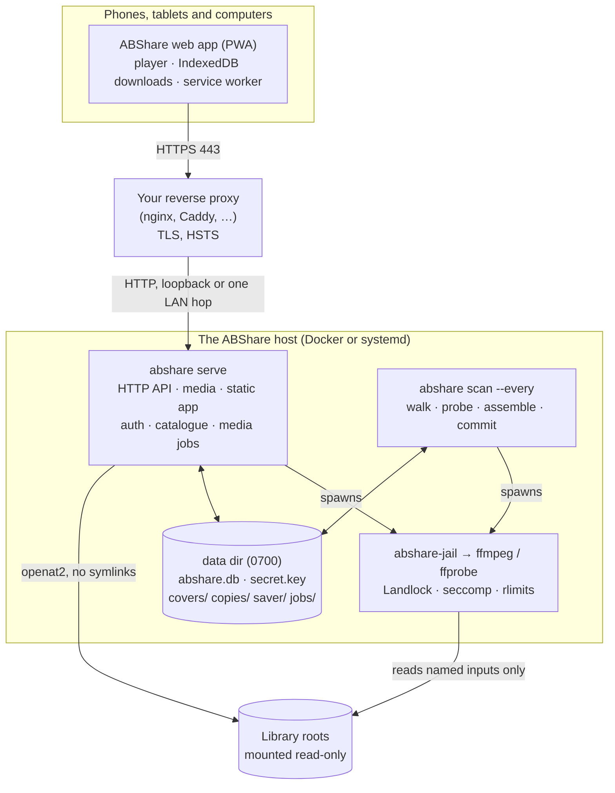
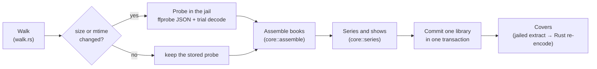
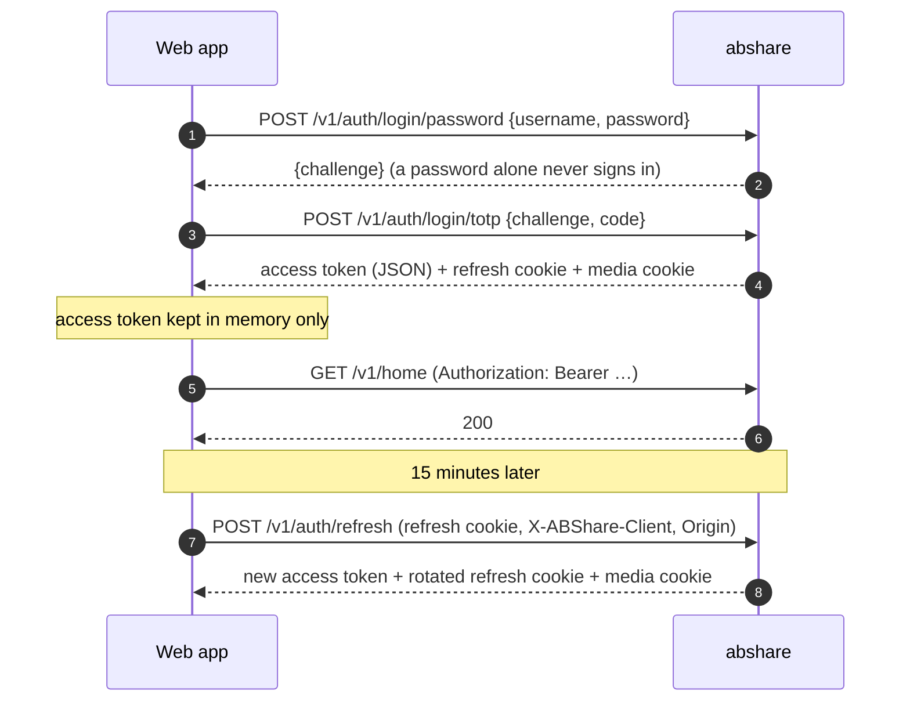
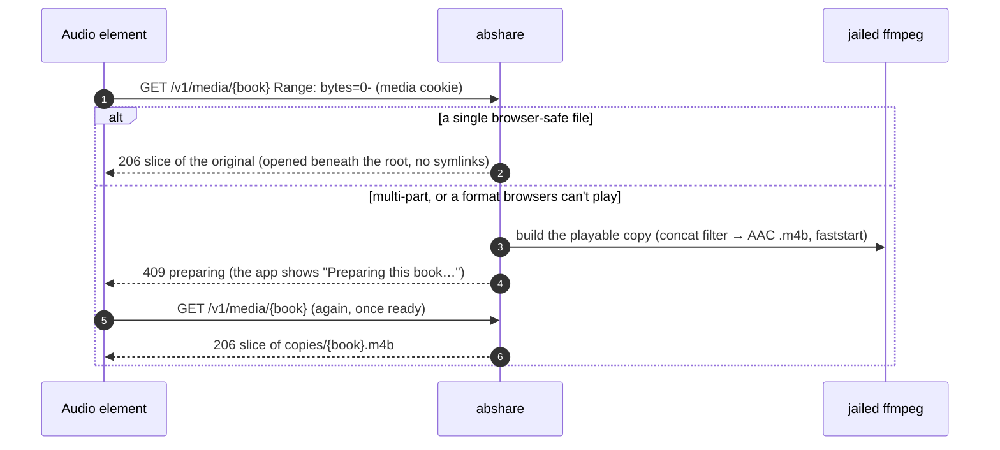
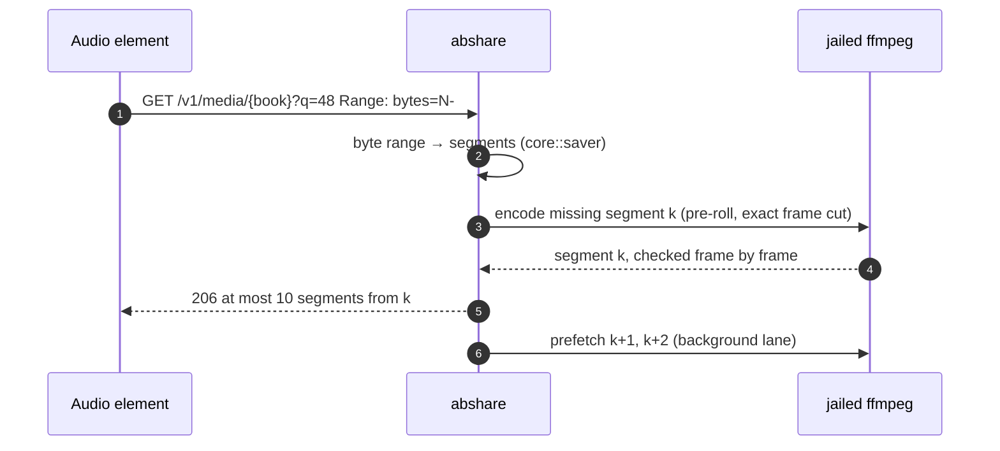
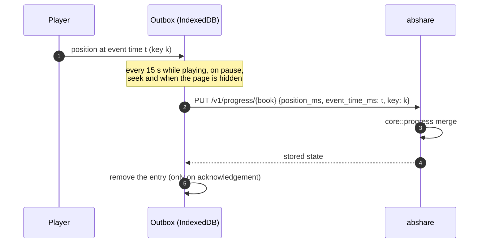
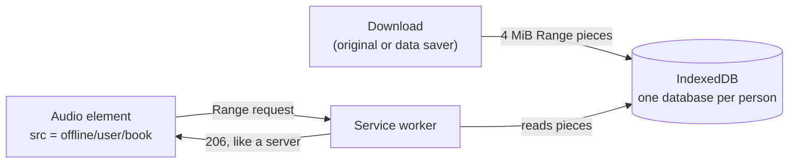

# Architecture

How ABShare is put together: the components, the trust boundary, what happens on each kind of request, and where data lives. This describes what is built. The reasons behind each choice are recorded as decisions (D1–D25) in [`SPEC.md`](../SPEC.md); the wire format of every endpoint is in [`API.md`](API.md).

## Contents

1. [Overview](#1-overview)
2. [Components](#2-components)
3. [Repository layout](#3-repository-layout)
4. [Trust boundary and threat model](#4-trust-boundary-and-threat-model)
5. [The library: scanning and book assembly](#5-the-library-scanning-and-book-assembly)
6. [Request flows](#6-request-flows)
7. [The ffmpeg jail](#7-the-ffmpeg-jail)
8. [Media jobs and the cache](#8-media-jobs-and-the-cache)
9. [The web app](#9-the-web-app)
10. [Data storage](#10-data-storage)
11. [Configuration and operation](#11-configuration-and-operation)
12. [Testing strategy](#12-testing-strategy)

## 1. Overview



ABShare is one Rust binary with an SQLite database. Two long-running processes share the data directory:

- **`abshare serve`** answers HTTP: the `/v1` API, audio under `/v1/media`, and the static web app. It holds the catalogue in memory, checks every session, and runs media jobs (playable copies and data-saver segments) through the jail.
- **`abshare scan --every SECONDS`** rescans the library on a schedule, and whenever an admin presses *Scan now* in the app. It probes only new or changed files and commits each library in one transaction. The server notices the change within seconds and reloads its catalogue.

The reverse proxy only terminates TLS and forwards requests. ABShare sets its own security headers, including the Content Security Policy, and decides for itself whether a request arrived over TLS (§4).

**Why this shape**
- One process and one trust boundary keep the code auditable. There is no separate file server to misconfigure: the process that checks the session also serves the bytes.
- Everything that interprets untrusted bytes is either in `core` (pure, memory-safe, fuzzed) or inside ffmpeg running in a jail with nothing to reach.
- Scanning runs in its own process, so a slow or stuck scan can't hold up streaming, and the scan service can run with no network at all (`PrivateNetwork=yes` in the systemd unit).

## 2. Components

| Component | Language | What it does |
|---|---|---|
| `core` | Rust, no I/O | Metadata normalisation and text cleaning, book assembly, series and show grouping, chapter maths, genre shelves, the progress merge, Range parsing, data-saver segment maths, ffprobe JSON parsing, auth rules (TOTP, lockout, validators, recovery codes), ID derivation, cache eviction choices, metadata overrides. |
| `server` (`abshare`) | Rust | HTTP (axum 0.8 on hyper 1), the request guard, auth and sessions, the SQLite store, the scanner, the jailed probe, covers, media jobs, the cache sweep, `doctor` and the admin CLI. |
| `jail` (`abshare-jail`) | Rust | Applies Landlock, seccomp, `no_new_privs` and resource limits, checks its inputs, then replaces itself with ffmpeg or ffprobe (§7). |
| `web/app` | TypeScript, Svelte 5 | The installable web app: Home, Library, Genres, book and series pages, the player, Downloads, Settings and Admin (§9). |
| `fuzz` | Rust | 11 `cargo-fuzz` targets over `core` (see [`fuzzing.md`](fuzzing.md)). |
| `deploy` | — | The Dockerfile, a Compose example, systemd units, nginx and Caddy examples, and the CI deploy test. |

Every Rust crate forbids `unsafe` code, and the release build aborts on panic, so a bug can never be caught and carried on from in an inconsistent state.

## 3. Repository layout

| Path | What |
|---|---|
| `core/src/` | The pure crate. `metadata.rs`, `text.rs`, `assemble.rs`, `series.rs`, `chapters.rs`, `genre.rs`, `progress.rs`, `range.rs`, `saver.rs`, `ffprobe.rs`, `cache.rs`, `metadata_override.rs`, `ids.rs`, and `auth/` (TOTP, lockout, validation, codes). |
| `core/data/` | The bundled breached-password list, stored as hashed prefixes. |
| `server/src/` | `main.rs` (subcommands), `config.rs`, `db.rs` (migrations), `walk.rs`, `probe.rs`, `scan.rs`, `catalogue.rs`, `library.rs`, `covers.rs`, `media.rs`, `tools.rs` (running the jail), `doctor.rs`, `admin.rs`, `auth/` (store, sessions, audit, crypto) and `http/` (router, guard and one file of routes per area). |
| `jail/` | `abshare-jail`: `filter.rs` (seccomp), `landlock_policy.rs`, and escape tests in `tests/escape.rs`. |
| `fuzz/` | Fuzz targets and dictionaries. |
| `web/app/` | The SvelteKit app: `src/routes/` (screens), `src/lib/api/` (HTTP, session, WebAuthn), `src/lib/player/`, `src/lib/offline/`, `src/lib/pwa/`, `src/service-worker.ts`, and tests. |
| `deploy/` | Container and service files, proxy examples, and `ci/` (the deploy test). |
| `tools/` | `check.sh` (every local gate), `check-private.py` (the pre-commit scan for private information), `mutation-check.py`, and `demo/` (synthetic libraries). |
| `docs/` | These documents, plus `security/` (threat model, ASVS map, reviews). |

## 4. Trust boundary and threat model

Everything arriving from the network is untrusted, and so is everything in the library: tags, chapter names, sidecar text and images can be crafted. The full threat model is in [`security/threat-model.md`](security/threat-model.md), and the OWASP ASVS 5.0 map in [`security/asvs.md`](security/asvs.md).

**At the front door** (every request, before routing):
1. **TLS.** A request counts as TLS only when a trusted proxy (`trusted_proxies`) says so with `X-Forwarded-Proto: https`, or when it comes from loopback. Anything else gets `403`.
2. **Host.** `Host` must match `public_origin`, or the answer is `421`. This defeats DNS rebinding and host-header tricks.
3. **Client address.** `X-Forwarded-For` is read from the right, skipping trusted hops, and believed only from a trusted proxy. IPv6 clients are grouped by /64 for rate limits and lockouts, so rotating through one allocation doesn't help an attacker.
4. **Limits.** 1,024 connections overall and 64 per address (trusted proxies are exempt, since behind a proxy every client shares its address). The first byte, the request head and the request body must each arrive within 15 seconds, and bodies are at most 64 KiB.
5. **Headers.** Every response, refusals included, carries the CSP, `nosniff`, `no-referrer`, frame denial, cross-origin isolation headers and a restrictive `Permissions-Policy`. `/v1` responses are `no-store`.

**Default deny.** Every route declares its authentication in one routing table. Every request body has a strict schema that refuses unknown fields. Every ID is checked for shape before any lookup, and every book is checked against the caller's library permissions. A book the caller may not see gets `404`, exactly like one that doesn't exist.

**No client-supplied paths.** A client only ever names a book ID: an HMAC of the book's identity under the server secret, truncated to 128 bits. The server resolves it to a path it found itself during a scan, and opens it relative to the library root with `openat2(RESOLVE_BENEATH | RESOLVE_NO_SYMLINKS)`, so neither `..` nor a symlink planted after the scan can lead outside.

**Untrusted metadata is rendered as text.** The server converts HTML descriptions to plain text with a bounded tokenizer of its own and strips control, bidi-override and invisible characters. The web app never renders server strings as HTML, and a source scan in its tests bans every HTML-injection API.

## 5. The library: scanning and book assembly



1. **Walk.** Each root is walked from an open directory handle. Symlinks are never followed, the walk never crosses into another filesystem, and it stops at a depth of 8. Hidden entries are skipped. Names that aren't valid UTF-8, control characters and special files are skipped and reported to admins. Only audio files, small `.txt` sidecars (up to 64 KiB) and JPEG or PNG images are considered.
2. **Probe.** A file is probed only when its size or modification time has changed since the last scan. ffprobe runs in the jail with the demuxer forced from the file's extension (`mov`, `mp3`, `ogg`, `flac`, `wav`) and only the `file` protocol. Its JSON output is capped at 4 MiB and parsed into strict types in `core`. The container must agree with the extension. DRM files (`.aax`, `.aa`) are refused.
3. **Trial decode.** Every new or changed file is decoded for 10 seconds from the start and 10 seconds from the middle. Any decoder error marks it unplayable, because ffmpeg can log a failure and still exit successfully (seen with xHE-AAC, which FFmpeg probes but can't decode).
4. **Assemble** (pure). Directories of probed files become books. Files with different ASINs or albums are separate books; copies of the same book are alternates, and the best one is chosen (it probes cleanly, has a browser-safe codec and the higher bitrate, and isn't a sync-conflict copy); the rest are parts, ordered by disc, track and then natural filename order. `CD1`/`CD2`-style subfolders join their parent.
5. **Group.** Books sharing a series (or a podcast's album) are grouped and classified as a **book series** or an episodic **show**, with no admin work. Shows are ordered by season and episode numbers parsed from titles (store `part` tags are often sentinels), with trailers and extras set aside.
6. **Metadata.** Tags are normalised (`core::metadata`): titles lose "(Unabridged)" and "Book N" suffixes, people are split on commas and semicolons only (never "and"), narrators come from `composer`, `narrator`, a sidecar or a "Read by" line, and genres are mapped onto 17 shelves (`core::genre`). An admin's corrections are applied on top and survive rescans.
7. **Commit.** Each library is replaced in one transaction. A book that disappears is marked missing, not deleted, so a remount doesn't lose anyone's place. A book whose audio changed has its playable copy and data-saver segments deleted.
8. **Covers.** The embedded picture is extracted by jailed ffmpeg, or a `cover.*`/`folder.*` sidecar is used. It is decoded in Rust (JPEG and PNG only, with size and allocation limits) and re-encoded as JPEG at 128, 320, 640 and 1,280 pixels, which strips metadata and neutralises malformed-image tricks.

After each pass the scanner writes `last-scan.json`, which the admin Library page shows, along with the problems list (unplayable files, ignored duplicates, unsupported formats, missing books).

## 6. Request flows

### 6.1 Sign-in and sessions



- **Invites.** An admin creates a single-use invite (72 hours by default). The token is in the link's fragment (`#/invite/…`), so it never reaches server or proxy logs, and the app posts it in a body. The invitee chooses a username, then a passkey (recommended) or a password plus an authenticator app, then saves ten recovery codes.
- **Tokens** are opaque 256-bit random values, stored only as hashes. The access token lasts 15 minutes and lives in memory. The refresh token lasts up to 90 days, sits in an `HttpOnly; Secure; SameSite=Strict` cookie scoped to `/v1/auth`, and is rotated on every use. A spent refresh token presented again is recognised: a retry after a lost response is allowed until one of its replacements is used, and after that it counts as theft, which signs the device out.
- **The media cookie.** `<audio src>` can't send a bearer header, so media requests carry a separate cookie scoped to `/v1/media`, renewed with each refresh and revoked with the device. No token ever appears in a URL.
- **CSRF.** Cookie-reading routes (`/v1/auth/*`) need the `X-ABShare-Client` header and an exact `Origin`. Everything else uses bearer tokens. No CORS preflight is ever approved.
- **Lockouts** count failures per address (/64 for IPv6) and per username. The per-username lock is soft: other addresses share a small allowance, and a browser already signed in to the account skips it, so a stranger can't lock you out.
- **Step-up.** Changing sign-in methods and every admin write need a fresh second factor from the last 10 minutes: a passkey, or a password with a code.
- **Devices.** Each sign-in is a device. You can see yours and sign any of them out (another device needs a step-up). A device signed out remotely wipes its downloads the next time it runs. Changing the password, or removing or replacing a factor, signs out every other device.
- **Recovery codes.** A recovery-code sign-in is limited to the account pages until a new passkey or authenticator app is set up; it counts as a step-up, so that can be done at once.
- **The audit log** records sign-ins, failures, locks, enrolment, factor changes, invites, device sign-outs and admin actions. Each row carries an HMAC of the one before, and a tagged head and anchor make a removed tail detectable. Admins can see whether the chain is intact.

### 6.2 Browsing

The server keeps the catalogue in memory and reloads it when a cheap database stamp changes (checked at most every 5 seconds), so browsing and search never touch the disk. Every listing is filtered by the caller's library permissions. Search is a substring match over folded text (titles, people, series and genres), capped at 200 characters and 8 words.

### 6.3 Streaming



Every book plays as one file on one timeline, so positions, chapters, downloads and the lock screen all work in milliseconds of one file. Playback is a plain `<audio>` element with HTTP Range requests: no HLS and no Media Source Extensions, which is what keeps iOS playing in the background.

### 6.4 Data saver

The data-saver stream is a **virtual constant-bitrate MP3**: MPEG-2 Layer III at 24 kHz mono, where every frame is exactly 576 samples (24 ms) and a whole number of bytes (144 bytes at 48 kb/s). The server therefore knows the exact length of the whole book's MP3 before any of it exists, and can answer any byte range by working out which 60-second segments (2,500 frames) it touches.



- Each segment is encoded with the bit reservoir off and a pre-roll aligned to both the frame and the resampling grid, then cut on exact frame boundaries, so segments join with no gap or click.
- A response covers at most 10 segments; the media element simply asks again. A request with no Range header is treated as `bytes=0-` and capped the same way.
- **Latest seek wins.** When a listener scrubs, a newer request from the same device drops any older one still waiting for the encoder, so the final position is answered quickly.
- Positions are in milliseconds on both sources, so switching quality mid-book keeps your place.
- Downloads ask with `dl=1`. The server then encodes each span of up to 10 missing segments in one ffmpeg run and starts the next span while the current one is sent, which makes a whole-book data-saver download one pass of transcoding.

### 6.5 Progress



- The merge (pure and property-tested) accepts an event only if it is newer than the stored one, refuses event times more than 5 minutes in the future or more than 90 days old, clamps positions to the book, and treats a repeated idempotency key as a no-op that returns the stored state.
- A book is finished when the position is within 30 seconds of the end (or 2 % of the length for short items, whichever is smaller), or when the listener marks it.
- Offline, entries wait in the per-user outbox, newest replacing older unsent positions, and are flushed oldest first when the device is back online.
- When a paused player sees a newer position from another device, it follows it.

### 6.6 Downloads and offline playback



- A download fetches the book in 4 MiB Range pieces into a database for that user alone, with the book's details and cover, so the book page and the player work with no connection. Downloads run while the app is open and resume piece by piece, checking the ETag so a changed book restarts cleanly.
- Offline playback goes through the service worker, which answers the player's Range requests from the stored pieces exactly as the server would. This works for books of any size, on iOS and Android.
- Signing out offers to keep or remove downloads. Another person signing in on the same browser never sees the first person's books. A remotely revoked device wipes its downloads when it next hears from the server.
- Offline, the app plays the last person's downloads without the server, so a revocation takes effect only when the device is back online. This is an accepted risk ([`SPEC.md`](../SPEC.md) §8.3.1).

## 7. The ffmpeg jail

Media parsers are the largest attack surface in any media server. ABShare assumes ffmpeg can be compromised by a crafted file and makes sure that gains nothing.

```
abshare ──spawn──▶ abshare-jail --read <input>… --write <job dir> --limits … -- ffmpeg <args>
                     │ refuse any inherited descriptor above 2
                     │ open each --read input with openat2(RESOLVE_NO_SYMLINKS)
                     │ rlimits: address space, CPU seconds, file size, open files, no core dumps
                     │ no_new_privs
                     │ Landlock (ABI ≥ 6): read the inputs, write the job dir, execute ffmpeg only,
                     │                     no TCP bind or connect, scoped signals and sockets
                     │ seccomp: no sockets of any family, no fork/vfork, clone only for threads,
                     │          no namespaces, ptrace, mounts, io_uring, BPF, memfd, module loading;
                     │          any foreign-architecture or x32 system call kills the process
                     └─execve──▶ ffmpeg (env cleared, fixed arguments, forced demuxer,
                                         -protocol_whitelist file)
```

- **Fixed arguments.** No shell, an empty environment, `-nostdin`, the input demuxer forced from a fixed table, only the `file` protocol, and `-enable_drefs 0` for MP4. Multi-part books are joined with the concat *filter* over explicit inputs, never the concat demuxer or protocol.
- **Bounded output.** Standard output is capped per job and standard error at 64 KiB. Every job has a wall-clock timeout and is killed if its caller goes away. Output is written in a job directory and moved into place only when complete, so a crashed job leaves nothing that could be served.
- **Tested.** `jail/tests/escape.rs` proves a jailed process can't read outside its inputs, write outside its job directory, open any socket (including Unix sockets on the host and x32 system calls), start another program or follow a planted symlink. Removing each protection makes at least one test fail.
- **Checked live.** `abshare doctor` and the admin overview start a real jailed ffmpeg to confirm the sandbox works in the running environment. Without Landlock, media jobs fail and the admin overview says so.

## 8. Media jobs and the cache

- **Lanes.** Jobs run in in-memory lanes: one for segments a listener is waiting on, one for prefetch, read-ahead and downloads (sized by `[ffmpeg] jobs`, up to 8), and one for playable copies. At most 4 read-aheads run at once. Identical jobs are deduplicated.
- **Playable copies** are built on demand when a book that needs one is first played, downloaded or saved. A failed build backs off (5 minutes, doubling to a day) and the book reports `unplayable` meanwhile.
- **The cache** (`copies/` and `saver/`) is capped by `[cache] max_gib` (10 GiB by default). A sweep at start-up and every 10 minutes evicts the least recently used books down to 90 % of the limit. Books served in the last 30 minutes are kept, unless the cache has grown past twice the limit.

## 9. The web app

- **Stack.** SvelteKit 2 with Svelte 5 runes and TypeScript, built with the static adapter and a hash router, served by `abshare` itself. Only development dependencies, exactly pinned; no runtime dependencies at all.
- **Content Security Policy.** `script-src 'self'` with no inline scripts (the build moves SvelteKit's boot script into a file and fails on any inline script, `on*=` attribute or `javascript:` URL), and `require-trusted-types-for 'script'`. Only two Trusted Types policies may exist: `abshare-sw`, which accepts exactly one value (the app's own service-worker URL), and Svelte's own for its compiled templates.
- **The player.** One `<audio>` element, created once and reused for every book (iOS ties background permission to the element). The Media Session API provides lock-screen metadata and controls: play, pause, skip, seek, and previous and next chapter. The sleep timer runs from playback events, not timers, so it survives background throttling. Auto-rewind steps back a little after a pause, more after a longer one.
- **Service worker.** Caches the app shell only (cache-first for immutable assets, network-first for the page and manifest), never touches the API, audio or covers, and serves offline books from IndexedDB (§6.6). A new version waits and the app offers to reload, rather than changing under someone mid-chapter.
- **Per-user storage.** Downloads, the progress outbox and per-book speeds are kept per person, and removed with that person's downloads.
- **Accessibility.** Buttons and rows are at least 44 pixels tall, WCAG contrast is tested for every theme and mode, and every gesture has a button.

## 10. Data storage

### 10.1 On the server

| Path (in the data dir) | What |
|---|---|
| `abshare.db` | SQLite (WAL, foreign keys, secure delete): the catalogue (libraries, files and their probes, books, parts, chapters, groups, problems), accounts (users, passkeys, recovery codes, invites, devices, refresh tokens), listening (progress, idempotency keys, bookmarks), admin corrections to book details, and the audit log with its head and anchor. Schema changes are numbered migrations; a database newer than the binary is refused. |
| `secret.key` | 32 random bytes (mode 0600), created at first start. Keys for book IDs, TOTP seed encryption and the audit chain are derived from it with distinct labels. Back it up with the database: without it, book IDs and authenticator enrolments are lost. |
| `covers/` | Re-encoded cover JPEGs, keyed by book and source fingerprint. |
| `copies/` | Playable `.m4b` copies. |
| `saver/` | Data-saver segments, per book and bitrate. |
| `jobs/` | Work in progress; leftovers are cleaned at start-up. |
| `last-scan.json`, `scan-requested` | The last scan's summary, and the trigger file the *Scan now* button writes. |

Passwords are argon2id hashes; tokens, invites and recovery codes are stored only as hashes; TOTP seeds are encrypted with a key from the separately stored secret. A copy of the database alone yields no usable credentials. What is stored and for how long is set out in [`PRIVACY.md`](PRIVACY.md).

### 10.2 In the browser

- **Memory:** the access token.
- **Cookies:** the refresh cookie (`/v1/auth`) and the media cookie (`/v1/media`), both `HttpOnly; Secure; SameSite=Strict`.
- **IndexedDB:** one database per person, holding downloads, book details and covers for offline use, and the progress outbox.
- **localStorage:** appearance and playback preferences, per-person book speeds, and the last book played.
- **Cache Storage:** the app shell, kept by the service worker.

## 11. Configuration and operation

- **`abshare.toml`** holds deployment settings: the listen address, data directory, public origin, trusted proxies, the web app directory, ffmpeg paths and job count, the cache limit, and the libraries. Unknown keys are refused. The server refuses to start if the config or data directory is writable by others, or if a library root is writable by its own user. The library must be read-only.
- **Subcommands:** `serve`, `scan` (once, or `--every SECONDS`), `doctor`, `check-config`, and `admin` (`invite`, `reset`, `users`, `devices`, `revoke-all`, `verify-audit`). The server picks up sign-outs and changes made from the command line within 30 seconds.
- **Deployment:** the Docker image (non-root, read-only root filesystem, all capabilities dropped) or the systemd units (an exposure score of 1.5 or less, checked in CI), behind nginx or Caddy. See [`DEPLOY.md`](DEPLOY.md).

## 12. Testing strategy

Every change ships with tests, security first. The full strategy is in [`SPEC.md`](../SPEC.md) §13.

- **Security.** Negative tests for every externally reachable surface: about 75 HTTP tests over the real router, many of them checking several refusals each (forged, expired and revoked tokens; other people's books; CSRF and `Origin`; wrong `Host`; spoofed `X-Forwarded-For`; oversize and slow bodies; rate limits), jail escape tests, and a mutation check that removes each security control and confirms a test fails. Every security fix has a regression test that fails without it.
- **Parsers.** Each parser of untrusted bytes has a `cargo-fuzz` target and robustness tests and must never panic. CI runs every target on every push.
- **Stability.** Unit and property-style tests for the progress merge, Range requests, data-saver segment maths, book assembly and the lockout state machine.
- **The demo library, end to end.** `tools/demo/make-library.sh` builds a library of every shape and quirk; a test scans it with the real jail and ffmpeg, then browses, streams the original with Range requests, builds a playable copy, streams data saver, downloads for offline listening and syncs progress through the real router. CI requires Landlock, so the jail tests and this one can't skip there.
- **The web app.** Type checks with warnings as errors, unit tests for the player rules, offline storage, downloads and themes, the HTML-injection source scan, and the build-time inline-script check.
- **Deployment.** CI builds the image, runs it behind nginx with TLS and checks redirects, the single CSP, cookie flags, the `Host` check and spoofed client addresses; scans the image for known vulnerabilities; and checks the systemd units' exposure scores.

`tools/check.sh` runs the formatting, lint, Rust test and web gates locally; CI adds the supply-chain checks, fuzzing and the image tests. How to run each is in [`BUILDING.md`](BUILDING.md).
